<div align="center">

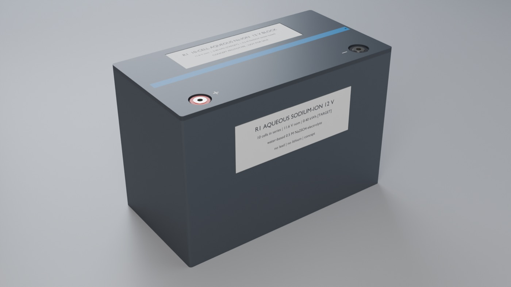

# Salt Battery Lab

**A fully rebuildable engineering and business study of a sodium "salt battery" startup.**
<br>
It covers DFT and ML-potential chemistry, cell models, CAD, PCB and firmware, techno-economics, and an honest go/no-go verdict.

[](https://github.com/sinhaaditya5/salt-battery-lab/actions/workflows/ci.yml)


[Verdict](#-the-verdict) · [Gallery](#-gallery) · [Pipeline](#-how-the-lab-works) · [Layout](#-repository-layout) · [Quick start](#-quick-start) · [Evidence rules](#-evidence-rules) · [Docs](#-documentation)

</div>

---

> [!IMPORTANT]
> **Stage: pre-prototype. No cell has been built, so nothing here is measured.**
> Every number is tagged `[LIT]`, `[VENDOR]`, `[CALC]`, `[SIM]`, `[ASSUMPTION]` or `[TARGET]` (in Project Salt: `[PUBLISHED]`, `[CALCULATED]`, `[SIMULATED]`, …).
> Each tag resolves to a row in [`CLAIMS_LEDGER.csv`](CLAIMS_LEDGER.csv). The test suite fails if anything is ever tagged `[MEASURED]`.

## 🧭 What this is

This repository is the full lab notebook for a battery startup idea, written as code. It started with one question: *could a water-based (aqueous) sodium-ion battery be the "battery you're allowed to put indoors" for data-centre and telecom UPS in India?* It then tested a second, harder brief, **Project Salt**: can common salt deliver 360 Wh/kg, a 5-minute charge for 1,500 km and a $3 cost?

Every chart, CAD model, drawing, board, spreadsheet, deck and memo here is **generated by a script**. All of it rebuilds with one command (`./run_all.sh`).

| | |
|---|---|
| 🔬 **Chemistry** | uMLIP screen (MACE-MP-0 / CHGNet) and two DFT(+U) campaigns on AWS: Quantum ESPRESSO 7.6 with U-scan, FM/AFM order, band gaps and PDOS |
| ⚡ **Cell models** | PyBaMM DFN validation (it fails its own voltage gate; documented), R1 cell Monte Carlo, gas/water budget, thermal and abuse, fast-charge limits |
| 🏭 **Product** | R0 test cell, R1 12 V monobloc, 48 V tray, UPS cabinet, S-cell, P1 cell, SM-48T module, SC-UPS-1: STEP/STL/GLB and dimensioned drawings |
| 🔌 **Electronics** | Two KiCad 10 boards (BMS monitor, SCM-1 salt-cell test monitor), Gerbers, BOM, and C firmware with host-side unit tests |
| 💰 **Business** | TEA and cost waterfall, UPS TCO, TAM/SAM/SOM, 30-architecture feasibility matrix, factory scenarios, live-formula spreadsheets |
| 📑 **Outputs** | Investor deck (28 slides), technical report, one-pager, YC W27 application, narrated explainer video, data room, decision memo |

## ⚖️ The verdict

> The salt is almost free; the battery is not.

**Aqueous sodium track:** [`DELIVERABLES/STARTUP_DECISION_MEMO.md`](DELIVERABLES/STARTUP_DECISION_MEMO.md)
- **No-go** on a manufacturing company on today's evidence.
  - The bottom-up 12 V block stores **17.6 Wh/kg** `[CALC; C-115]` and costs **~$350/kWh** `[CALC; C-122]`.
  - LFP packs sell at **$70/kWh** `[LIT; C-005]`.
- **Go-with-conditions** on a 12-week falsification sprint (≤ ₹10 lakh `[ASSUMPTION]`) that starts with a near-free buyer test.

**Project Salt:** [`PROJECT_SALT/00_START_HERE/EXECUTIVE_VERDICT.md`](PROJECT_SALT/00_START_HERE/EXECUTIVE_VERDICT.md)
- **Outcome B:** no salt-derived chemistry meets 360 Wh/kg + 5-min / 1,500 km + $3 + non-flammable.

| Founder target `[TARGET]` | Finding | Tag |
|---|---|---|
| 360 Wh/kg cell | Best salt-derived cell (anode-free Na solid-state, N08) reaches P50 **259**, P90 **292** Wh/kg | `[CALCULATED]` |
| 5-min charge for 1,500 km | Needs **3.8 MW** for 5 min, above the 3.75 MW MCS connector ceiling | `[CALCULATED]` |
| $3 cost | Inactive parts alone cost more than $3/kWh in every architecture. Salt + iron reactant cost is **$0.26/kWh** | `[CALCULATED]` |
| Non-flammable, from salt | Only metal-chloride cells (ZEBRA-type, 190–350 °C) use salt as the active material | `[PUBLISHED]` |

The closest candidates are **N08** (energy), **S03 salt-iron** (salt as the active material) and **N02 NFPP Na-ion** (balance). None of them wins. The [executive verdict](PROJECT_SALT/00_START_HERE/EXECUTIVE_VERDICT.md) names the exact three-part breakthrough that salt-iron would need.

## 🖼 Gallery

<table>
<tr>
<td width="50%">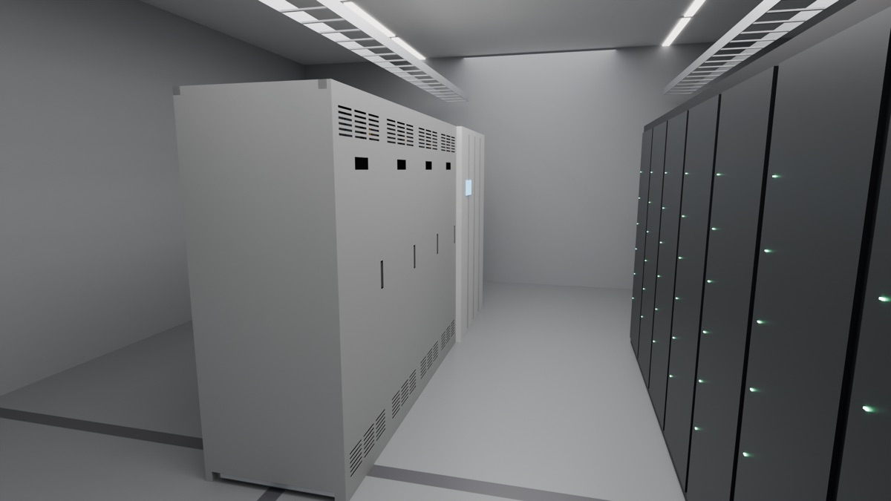<br><sub><b>R1 UPS cabinet in a data-centre room</b> (Blender concept render)</sub></td>
<td width="50%">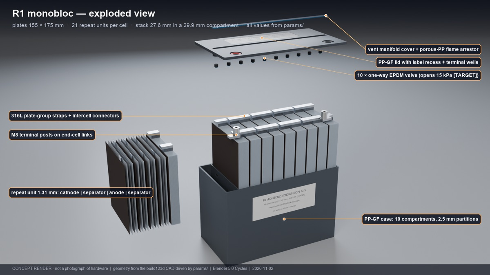<br><sub><b>R1 monobloc, exploded and annotated</b> (from <code>cad/make_cad.py</code>)</sub></td>
</tr>
<tr>
<td>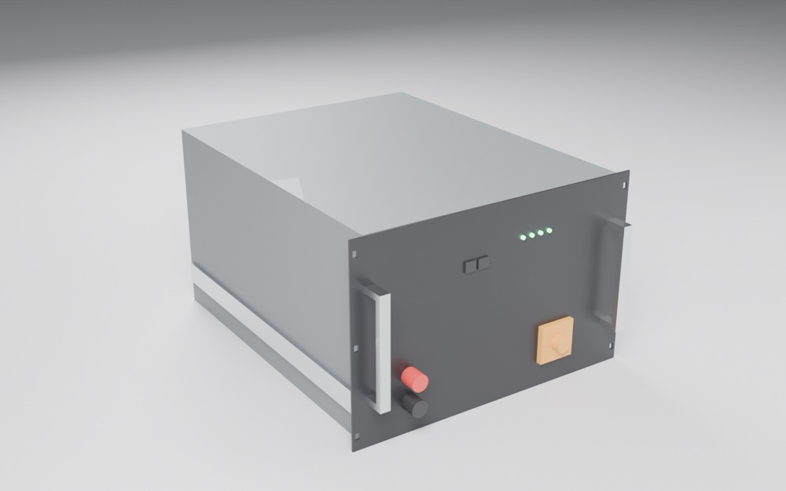<br><sub><b>SM-48T 48 V salt-iron module</b> (v1.1, <code>cad/make_smodule.py</code>)</sub></td>
<td>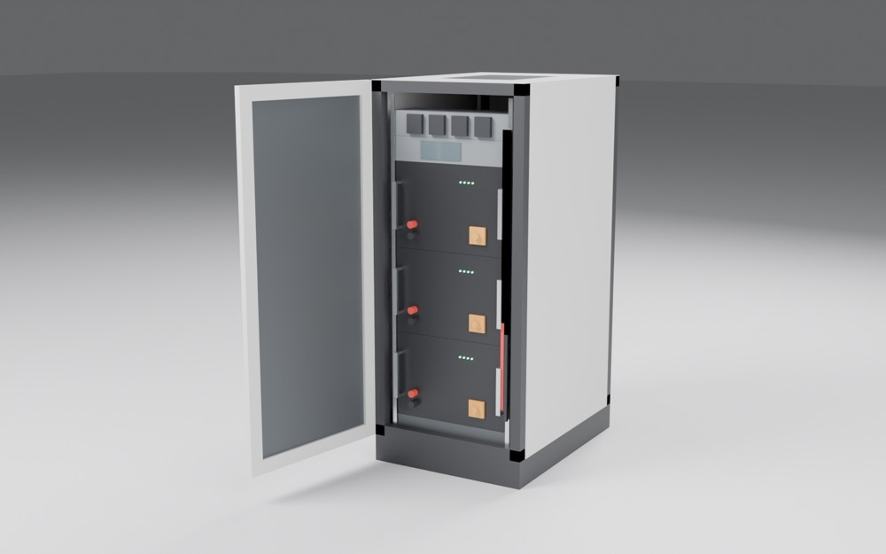<br><sub><b>SC-UPS-1 cabinet, doors open</b> (v1.1)</sub></td>
</tr>
<tr>
<td>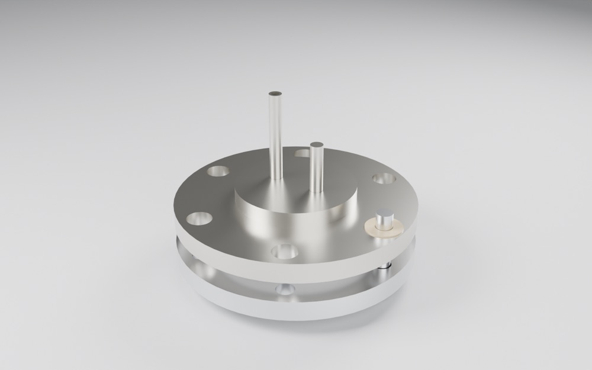<br><sub><b>S-cell R0 test cell</b> (<code>cad/make_scell.py</code>)</sub></td>
<td>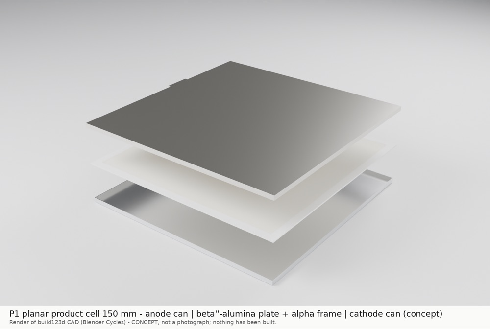<br><sub><b>P1 planar salt-iron cell, exploded</b></sub></td>
</tr>
<tr>
<td>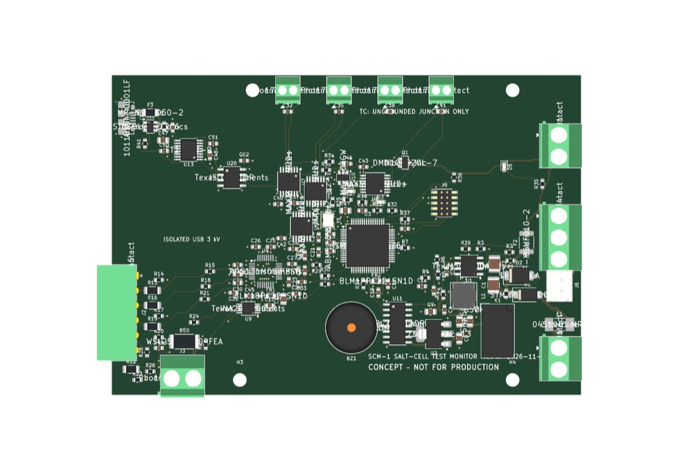<br><sub><b>SCM-1 salt-cell test monitor</b>, KiCad 10 (layout is a <b>draft</b>, not for fabrication)</sub></td>
<td>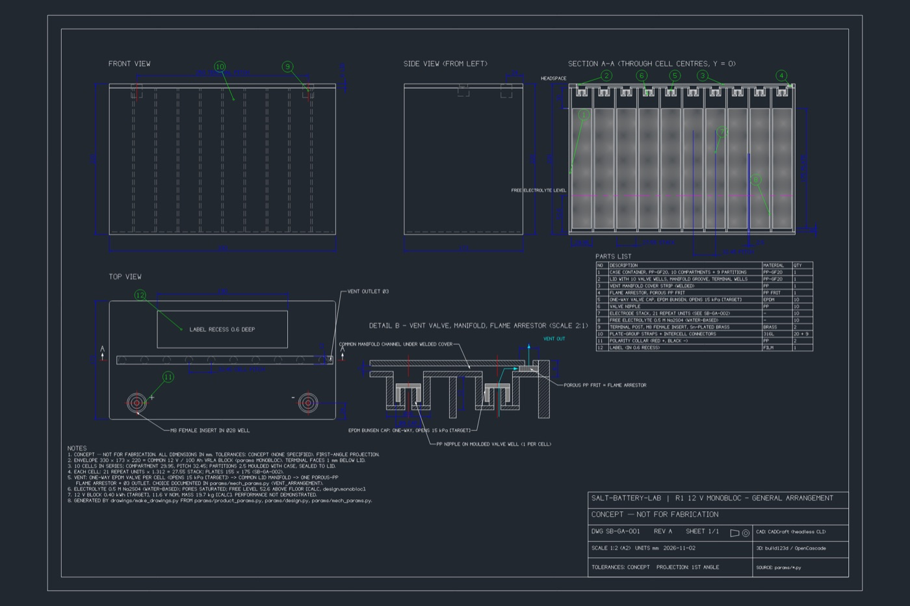<br><sub><b>Drawing SB-GA-001</b>, general arrangement (concept only)</sub></td>
</tr>
</table>

<details>
<summary><b>Diagrams and simulation charts</b> (click to expand)</summary>

<br>

| | |
|---|---|
| 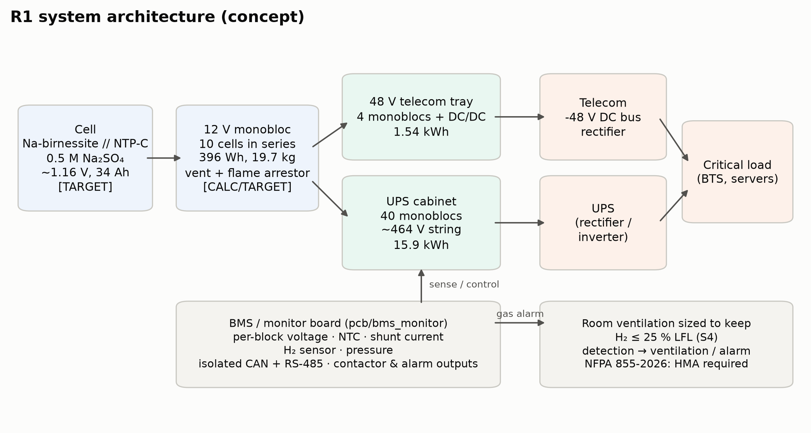 |  |
| 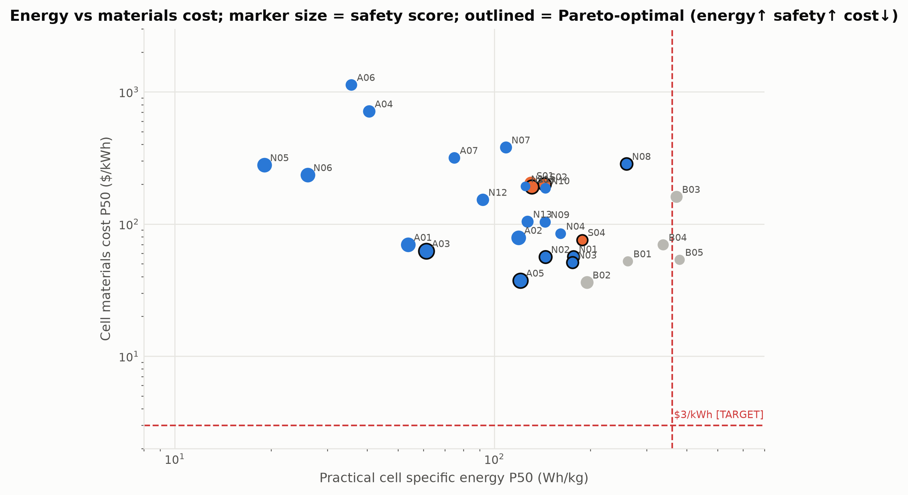 | 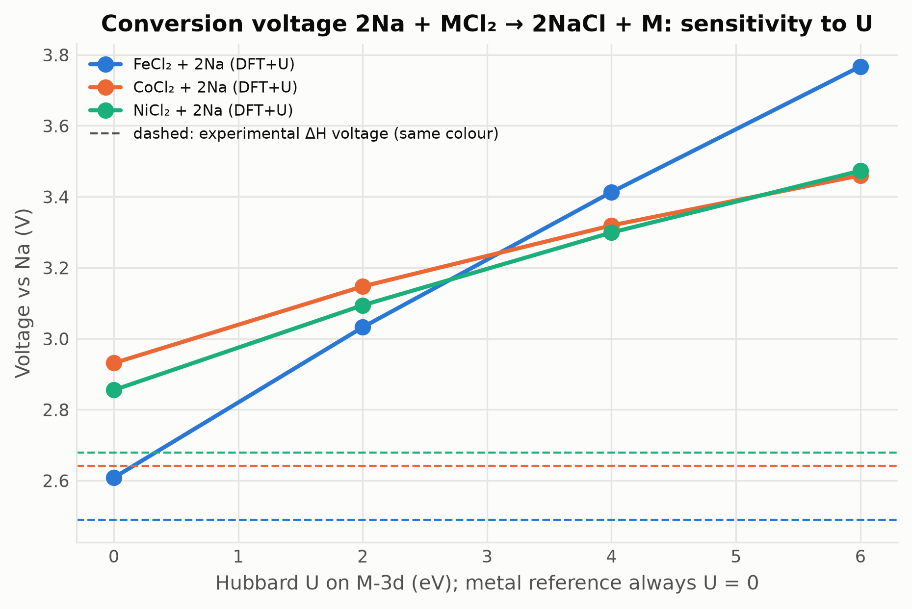 |
|  | 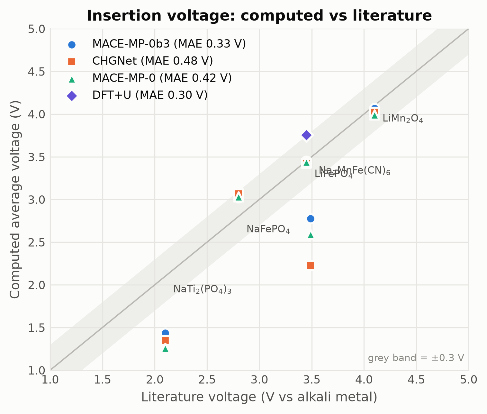 |
| 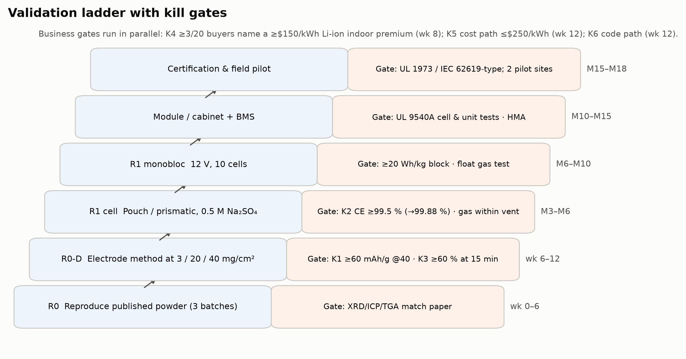 | 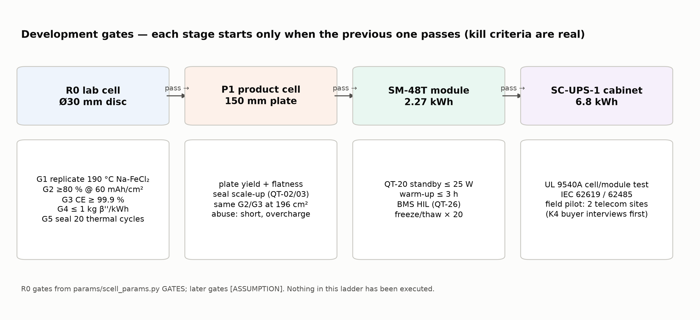 |

Every chart also exists as a 300 dpi PNG and an SVG, with a `.caption.txt` file that carries its claim tags ([`DELIVERABLES/7_simulation_charts`](DELIVERABLES/7_simulation_charts)).

</details>

## 🔧 How the lab works

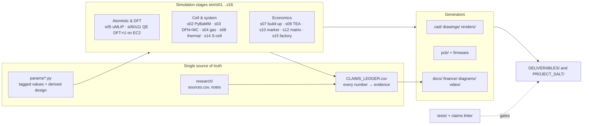

- **One parameter set.** [`params/product_params.py`](params/product_params.py) holds every tagged value. [`params/design.py`](params/design.py) derives geometry, mass and energy from it. CAD, simulations, spreadsheets and documents all read from here.
- **One stage per folder.** Each `sim/sNN_*` folder has a README, code and an `out/` folder with JSON results and charts.
- **One command.** [`run_all.sh`](run_all.sh) rebuilds everything in dependency order and never launches cloud machines.
- **Tests as guardrails.** [`tests/`](tests) checks physics (Faraday and Nernst conservation, energy identities), CAD against params, ERC/DRC, firmware limits against params, and a document linter. The linter requires a claim tag next to every number in the deck, report and one-pager.

## 📁 Repository layout

```text
.
├── params/                 single source of truth (tagged values → derived design)
├── sim/                    s01…s16: one folder per simulation stage (README · code · out/)
│   ├── s05_atomistic/        uMLIP relax + NEB (MACE-MP-0, CHGNet)
│   ├── s06_dft_ec2/          DFT+U package and runs on AWS Graviton spot
│   └── s11_dft_chlorides/    Na / NaCl / Cl2 / Fe-Co-Ni chloride DFT+U campaign
├── cad/ drawings/ renders/ CAD (build123d), CADCraft drawings, Blender renders
├── pcb/                    KiCad generators, two boards, firmware (C, host-tested)
├── diagrams/ finance/ docs/ video/   chart, spreadsheet, report, deck and video generators
├── research/               sources.csv (164 sources), notes, competitors, grants
├── decisions/              IDEA_v2, decision log, red team, chemistry matrix
├── tests/                  pytest suites (params · models · CAD · PCB · DFT · docs lint)
├── tools/                  env, plot style, EC2 build host, package assembly, pseudopotentials
├── DELIVERABLES/           investor docs, CAD, charts, data room, YC application
├── PROJECT_SALT/           second brief: 14-section package, start at 00_START_HERE/
├── 00_source_kit/          read-only R0 reference-cell kit (50/50 SHA-256 verified)
├── CLAIMS_LEDGER.csv       evidence register for every number
└── run_all.sh              rebuild everything
```

## 🚀 Quick start

> [!NOTE]
> The scripts expect the lab root at `/Volumes/Aditya ssd/Salt-Battery-Lab`, the founder's external SSD. On any other machine, symlink that path to your clone. The EC2 build host and CI both do this. See [`docs/REPRODUCIBILITY.md`](docs/REPRODUCIBILITY.md).

```bash
git clone https://github.com/sinhaaditya5/salt-battery-lab.git
cd salt-battery-lab

# 1. Python 3.12 environment (full pinned lock: tools/ec2_build/requirements.txt)
make setup              # uv/pip venv + CI requirements
make fetch-assets       # MACE-MP weights + Freerouting (SHA-256 verified)

# 2. Checks
make test               # pytest suites that need no CAD/DFT toolchain
make firmware-test      # SCM-1 firmware host unit tests (C11, -Werror)

# 3. Rebuild everything (needs Blender, KiCad, CADCraft, LibreOffice; see docs)
./run_all.sh --fast     # ~15 min: reuses ML-potential runs and renders
./run_all.sh            # full: also re-runs the uMLIP screen (~1 h) and renders
```

DFT is **never** re-run automatically: it costs money. Results are re-analysed from `sim/s06_dft_ec2/runs*/` and `sim/s11_dft_chlorides/runs/`. Launching new jobs on AWS is documented in [`sim/s06_dft_ec2/README.md`](sim/s06_dft_ec2/README.md).

## 🧪 Evidence rules

| Tag | Meaning |
|---|---|
| `[LIT]` / `[PUBLISHED]` | Peer-reviewed or primary published source, logged in `research/sources*.csv` |
| `[VENDOR]` / `[VENDOR CLAIM]` | A company's own claim; not independently verified |
| `[CALC]` / `[CALCULATED]` | Arithmetic or a model in this repo from tagged inputs |
| `[SIM]` / `[SIMULATED]` | Output of a simulation in `sim/`, with its validation status stated |
| `[ASSUMPTION]` | A ranged guess (low / base / high), used in sensitivity analysis |
| `[TARGET]` | A goal, not a result |
| ~~`[MEASURED]`~~ | **Banned until a real cell is tested.** `tests/test_params.py` enforces this |

Validation status is reported honestly. For example, the shipped PyBaMM sodium DFN **fails** the 60 mV independent-validation gate (67–121 mV) and is recorded as a failure (`[C-102]`).

## ✅ Quality gates

| Gate | Where | Status |
|---|---|---|
| Unit, conservation and regression tests (80 tests on the EC2 build host) | `tests/` | 78 pass · 2 skipped · 0 fail (`tests/junit_ec2.xml`) |
| Kit re-run vs expected outputs | `sim/s01_kit_rerun` | 9/9 pass |
| PyBaMM independent validation (MAE ≤ 60 mV) | `sim/s02_pybamm_validation` | **FAIL**, documented |
| Document claims linter | `docs/lint.py` | 0 problems |
| SCM-1 ERC | `pcb/scell_monitor` | 0 violations (layout is still a draft) |
| Firmware host tests | `pcb/scell_monitor/firmware` | 19/19 pass |
| CI (lint, JSON/CSV integrity, firmware, core tests) | `.github/workflows/ci.yml` | see the badge |

## 📚 Documentation

| Start here | |
|---|---|
| [`PROJECT_SALT/00_START_HERE/EXECUTIVE_VERDICT.md`](PROJECT_SALT/00_START_HERE/EXECUTIVE_VERDICT.md) | Project Salt outcome, candidates, recommendation |
| [`DELIVERABLES/STARTUP_DECISION_MEMO.md`](DELIVERABLES/STARTUP_DECISION_MEMO.md) | Aqueous-track go/no-go, proven vs simulated vs assumed, first 90 days |
| [`docs/ARCHITECTURE.md`](docs/ARCHITECTURE.md) | How the parameter, simulation, generator and test layers fit together |
| [`docs/REPRODUCIBILITY.md`](docs/REPRODUCIBILITY.md) | Toolchain, environment, EC2 build host, fetched assets |
| [`docs/LAB_NOTEBOOK.md`](docs/LAB_NOTEBOOK.md) | The original lab README: deliverables index and rebuild table |
| [`DELIVERABLES/10_data_room/Data_Room_Index.md`](DELIVERABLES/10_data_room/Data_Room_Index.md) | Data room |
| [`PROJECT_SALT/13_RELEASE/known_limitations.md`](PROJECT_SALT/13_RELEASE/known_limitations.md) | What is not done, and why |
| [`CHANGELOG.md`](CHANGELOG.md) | Version history (v0.1 → v1.1) |

## 🗺 Roadmap

- [x] v0.x: aqueous Na-ion study, ten simulations, deck, report, decision memo
- [x] v1.0: Project Salt: DFT+U on chlorides, 30-architecture matrix, founder-target tests
- [x] v1.1: P1 cell, SM-48T module, SC-UPS-1 cabinet, thermal model, renders, drawings, spreadsheet
- [ ] 4-week buyer test (kill criterion K4). It applies whatever the chemistry
- [ ] Partner-lab S-cell R0 campaign: replicate PS-005, then test the thin-ceramic / thick-cathode lever (gates G1–G5)
- [ ] First `[MEASURED]` data point

## 🤝 Contributing and security

Corrections to sources and claims are the most valuable contribution. See [`CONTRIBUTING.md`](CONTRIBUTING.md) and the **Claim correction** issue template. To report a vulnerability or an exposed credential, see [`SECURITY.md`](SECURITY.md).

## 📄 License and citation

Copyright © 2026 Aditya. **All rights reserved.** The repository is public for review and reference; no licence to reuse it is granted (see [`LICENSE`](LICENSE)). Third-party components keep their own licences ([`THIRD_PARTY_NOTICES.md`](THIRD_PARTY_NOTICES.md)).

To reference this work, use [`CITATION.cff`](CITATION.cff) (GitHub's "Cite this repository" button).

<div align="center"><sub>Built with Python, Quantum ESPRESSO, PyBaMM, MACE, build123d, Blender, KiCad, CADCraft, LibreOffice and Octave.</sub></div>
