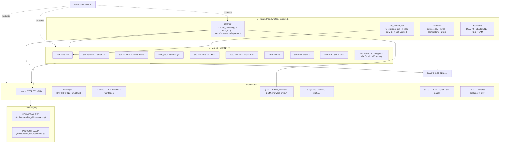

# Architecture

The lab is a **build system for an argument**. Every claim in the deck, report or memo traces back through a generator and a simulation to a tagged parameter or a logged source. One command can regenerate all of it.

## Layers

## Contracts between layers

| Contract | Enforced by |
|---|---|
| Every parameter has a tag, and assumptions have ordered low/base/high ranges | `tests/test_params.py` |
| Nothing is `[MEASURED]` | `tests/test_params.py`, `tests/test_project_salt.py` |
| Design identities hold (energy = n·V·Ah, the mass balance closes, the block fits its envelope) | `tests/test_params.py` |
| Simulations conserve charge and respect Nernst limits; the S2 failure stays recorded as a failure | `tests/test_sim_models.py` |
| CAD bounding boxes equal the parameters; no part clashes; the tray holds four monoblocs | `tests/test_cad_params.py` |
| DFT results are complete, converged and close to thermochemistry | `tests/test_s11_dft.py` |
| Firmware trip limits are generated from `params/scell_params.py`, never typed by hand | `pcb/scell_monitor/firmware/gen_limits.py`, CI drift check |
| Every number in the deck, report and one-pager has a claim tag in the same paragraph or row | `docs/lint.py`, `tests/test_docs_lint.py` |
| No secrets, no oversized files, valid JSON/CSV/Python | `scripts/check_repo.py` (CI) |

## Conventions

- **Folder per stage.** `sim/sNN_name/` holds a `README.md` (question, method, validation status, result), the code, and `out/` (JSON plus PNG/SVG charts, each with a `.caption.txt` that carries claim tags).
- **Charts.** `tools/plotstyle.py` gives one visual style. Every chart is saved as a 300 dpi PNG and as an SVG.
- **Console evidence.** `tools/snap.py` renders console logs to PNG under `DELIVERABLES/11_screenshots/`, so runs can be audited without re-running them.
- **Absolute lab path.** Scripts address the lab at `/Volumes/Aditya ssd/Salt-Battery-Lab`. Other machines expose their checkout there with a symlink (`make link`); the EC2 host and CI already do. See [REPRODUCIBILITY.md](REPRODUCIBILITY.md).
- **Cloud is opt-in.** `run_all.sh` only re-analyses DFT outputs. Launching EC2 is a separate, capped and per-job-approved step.
